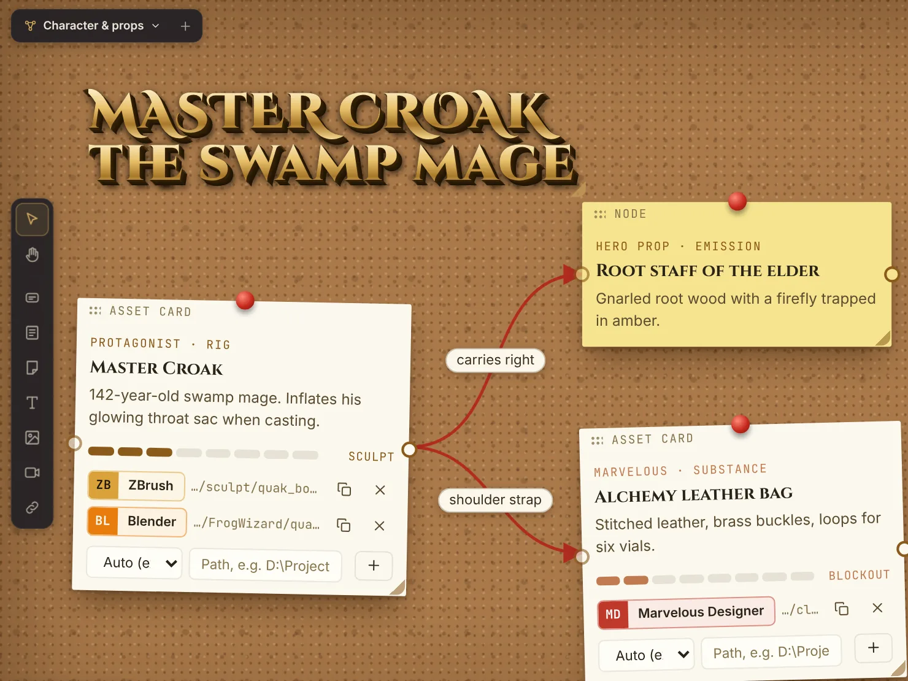

<p align="center"></p>
<h1 align="center">VertexForge Studio</h1>
<p align="center"><b>A free, open-source planning tool for 3D artists.</b><br>Pipeline, deadlines, mind board, shot list and story for a personal 3D project – in one calm place.</p>

<p align="center">
  <a href="https://janbromigo1996.github.io/vertexforge-studio/"><b>Website</b></a> ·
  <a href="https://janbromigo1996.github.io/vertexforge-studio/install.html"><b>Installation guide</b></a> ·
  <a href="https://janbromigo1996.github.io/vertexforge-studio/app/"><b>Open in browser</b></a> ·
  <a href="../../releases/latest"><b>Download</b></a>
</p>

<p align="center"></p>

## ⚠️ Built entirely with Claude

The code of this tool was written with **Claude**, an AI assistant by Anthropic, guided by me (Jan).
It **can contain mistakes and bugs**. That is exactly why it is open source: everyone is welcome to read the
code, report problems and make it better. The tool itself contains **no generative AI** and never creates art.

## Download

| Platform | What you get |
|---|---|
| **Windows 10/11** | `VertexForge-Studio-Setup.exe` from [Releases](../../releases/latest) – installer in 6 languages, Start menu + desktop shortcuts, clean uninstall |
| **macOS / Linux** | The browser version – [open it on the website](https://janbromigo1996.github.io/vertexforge-studio/app/) or download `VertexForge-Studio-Browser.html` from [Releases](../../releases/latest) |

Step-by-step instructions (SmartScreen, updates, uninstalling, troubleshooting): **[Installation guide](https://janbromigo1996.github.io/vertexforge-studio/install.html)**

A native macOS app does not exist yet. Help is welcome!

## Features

- **Projects** – 2:3 poster covers with a title designer (50+ fonts, 3D extrusion, gold leaf, chrome, neon)
- **Pipeline** – phases, tasks, priorities (Low → Critical), effort, timeline, live countdowns, list or kanban
- **Mind board** – infinite canvas like PureRef: asset cards with stages, notes, titles, images, videos, linked files, docking, wires, Blender-style shortcuts (`Shift+A`, `G`, `S`, `X` …), six board styles (studio, pinboard, sketchbook, blueprint, chalkboard, glass)
- **Your files** – link `.blend`, `.ztl`, `.spp`, `.psd`, `.drp` … and open them in the right program (desktop app)
- **Shot list & story** – frames, lens, department status, timecode; a writing desk with a world bible
- **Safe saving** – autosave, `.vforge` files, incremental saves, restore points every 10 minutes and before every update
- **6 languages** – English, Deutsch, Français, Español, Italiano, Português

## Security

Every release is scanned with ClamAV before publishing, and SHA-256 checksums are listed on the website and in each release.
The app and the installer start **no scripts or command shells** (no PowerShell, no cmd) – everything uses plain Windows API calls.
No account, no tracking, no telemetry. See [SECURITY.md](SECURITY.md).

## My position on AI

> AI has no place in the final product of art and media. Human-made art, programs and tools always come first.

I'm Jan, an intermediate hobby 3D artist who mostly works in Blender. I used Claude to write the code for this planning tool
because I'm an artist, not a programmer. VertexForge only helps with planning and organisation – it never generates images,
models, textures or stories and is not meant to replace anyone. It's a small personal project that I hope is useful for others too.

## Build it yourself

Requirements: Python 3, Go 1.24+, [`go-winres`](https://github.com/tc-hib/go-winres).

```bash
python3 build.py --desktop                     # dist/vertexforge_studio.html + app/ (with offline fonts)
go-winres make --in winres/winres.json --arch amd64
GOOS=windows GOARCH=amd64 CGO_ENABLED=0 go build -trimpath -ldflags "-H windowsgui -s -w" -o "dist/VertexForge Studio.exe" .
cp "dist/VertexForge Studio.exe" installer/payload/app.exe
(cd installer && go-winres make --in winres/winres.json --arch amd64)
GOOS=windows GOARCH=amd64 CGO_ENABLED=0 go build -trimpath -ldflags "-H windowsgui -s -w" -o "dist/VertexForge Studio Setup.exe" ./installer
```

| Folder | Content |
|---|---|
| `src/` | The app (HTML template, styles, languages, modules) – `build.py` assembles it into one file |
| `main.go` | Windows wrapper (WebView2 window, file dialogs, opening files in programs, program icons) |
| `installer/` | Setup & uninstall wizard |
| `winutil/` | Small native Windows helpers (icons, shortcuts, folder picker) |
| `docs/` | The project website (GitHub Pages) incl. the browser version in `docs/app/` |
| `site/` | Website sources – run `python3 site/build_site.py` to rebuild `docs/index.html` and `docs/install.html` |

## Contributing

Bug reports, code review, translations and a native macOS version are especially welcome. See [CONTRIBUTING.md](CONTRIBUTING.md).

## License

[MIT](LICENSE) – use it, change it, share it.
